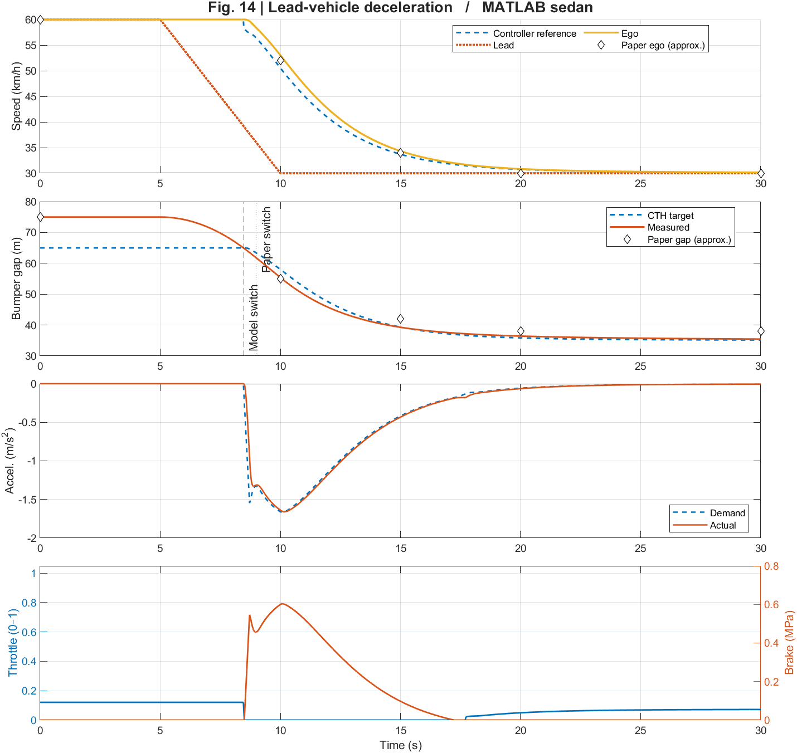

# Fei 与 Wang 分层 ACC 的 MATLAB / Simulink 复现

这套工程用于 AutoTech 6DV3 Project 1。主模型把论文图 8–10 的纵向控制器接到一个可独立运行的轿车模型上。先打开图 14 工况，观察前车减速后自车如何从巡航切入跟车，再用同一套控制器运行其余工况。独立控制器库也供 CarSim 接口模型调用。

## 1　从这里运行

把 MATLAB 的 Current Folder 切到同时含有 `run_baseline.m` 和三个 `.slx` 的文件夹。压缩包需先完整解压。验证环境为 MATLAB / Simulink R2024a，Update 3。

```matlab
open_system('acc_paper_baseline')          % 默认载入图 14，直接点 Run 可跑 30 s
open_system('acc_control_lib/ACC controller') % 看控制器内部的四个模块
M4 = run_baseline(4);                     % 重跑图 14，生成数据、对照表与图
M  = run_baseline;                        % 顺序运行六个工况并更新汇总
verify_carsim_interface                   % 重放图 14 的端口数据，检查单位和接线
```

打开 `results/fig14_deceleration.png` 看速度、净距、加速度和两种踏板指令。全部时间序列可在同名 CSV 中找到。交互查看细节时可以在 MATLAB 运行下列命令，切换点由日志自动读出。

```matlab
D = readtable('results/fig14_deceleration.csv');
D(find(diff(D.Mode)==-1,1)+1,{'Time_s','Ego_mps','Lead_mps','Gap_m','DesiredGap_m'})
plot(D.Time_s, 3.6*[D.Lead_mps D.Reference_mps D.Ego_mps])
xlabel('Time (s)'); ylabel('Speed (km/h)'); legend('Lead','Reference','Ego'); grid on
```

直接运行主模型会把 `accLog` 保存到模拟输出对象。批处理入口会拆分、标注各通道并导出图片和表格。原始设计源文件也已提供。修改控制器的 `.m` 文件后，在保存或关闭手工编辑过的模型后执行 `build_baseline`、`build_carsim_interface`、`run_baseline` 和 `verify_carsim_interface`。前两个命令会从源码重新生成模型。在 `baseline_case.m` 里单独修改工况后，直接运行批处理即可使用新输入。

## 2　沿着一圈闭环读懂模型

| 步骤 | 打开或查看 | 运算和物理作用 |
|---|---|---|
| ① 定义工况 | `baseline_case.m` 和主模型的 Lead and cruise scenario | 把驾驶员巡航设定与前车运动分开。前车速度对时间积分给出前车后保险杠位置。图 11 和图 12 改的是自车设定速度，图 13 和图 14 改的是前车速度。这样两组试验分别考查速度环和跟车闭环。 |
| ② 测量净距和相对速度 | Range sensor，`range_sensor.m` | 净距为前车后保险杠位置减自车前保险杠位置。相对速度为前车车速减自车车速，负值表示正在接近。仿真中用车辆真值构造 150 m 量程的理想传感器，避免将相机识别误差混入控制复现。无目标时有效位为 0，CSV 中对应测量留空值 NaN。 |
| ③ 计算车距和选择模式 | Distance and mode，`follow_reference.m` | 按公式 (5) 计算目标净距 `d*=5+3.6v`，其中车速用 m/s。例如 60 km/h 对应 65 m，30 km/h 对应 35 m。净距小于或等于目标时进入跟车。目标消失即回巡航，仍能看到前车时，只有净距超过目标 10 m 且间距正在增大或保持才退出。两个门槛防止边界处频繁切换。模式 1 为跟车，2 为巡航。 |
| ④ 将车距误差变成速度参考 | 同一模块中的外环 PID，论文图 9 | `e=d−d*`。误差为负时，控制器给出降速修正。外环按图示使用 P=0.8、I=0.07、D=0.3，速度修正按 km/h 解释，加到自车速度前除以 3.6。微分项利用 `de/dt=v_relative−3.6a_ego` 并经过一阶滤波。修正限幅后叠加到当前车速，总参考限制在 0 和驾驶员设定之间。积分器按 0.035 反馈已执行修正与未限幅修正之差，使解除饱和后可以恢复跟踪。 |
| ⑤ 速度误差变成加速度 | Speed loop，`speed_control.m` | 内环根据 `2.4(v_ref−v_ego)` 请求纵向加速度，随后施加 −4 至 +2.8 m/s² 的限幅和 6 m/s³ 的指令变化率限制。比例式速度环没有跨模式积分残留。此处变化率约束作用在指令上，实际车辆加加速度仍需由记录的加速度计算。 |
| ⑥ 加速度变成油门或液压制动 | Inverse dynamics，`inverse_actuators.m`、`baseline_forces.m` | 先求零踏板时的滑行加速度 `a_coast=−F_res/m_eff`。在其两侧各设 0.05 m/s² 的切换带，区内保留原驱动或制动状态。需要牵引时由轮上力、挡比、终传比、效率及发动机转速反求油门。需要制动时由轮端扭矩反求主缸压力。两个指令互斥。 |
| ⑦ 更新真实响应并反馈 | Sedan dynamics、Ego feedback，`sedan_step.m`、`baseline_gear.m` | 油门和液压分别经过一阶动态。驱动力扣除制动力、滚阻和风阻得到净加速度，进而更新车速和位置。Unit Delay 让控制器用当前已测状态计算下一拍输入，控制周期为 20 ms。车辆自身可换挡，低速制动时车速最低为零。 |
| ⑧ 在停车工况保持和释放刹车 | `follow_reference.m` 和 `inverse_actuators.m` 中的 hold 分支 | 当检测到前车已近乎静止、自车低于 0.55 m/s 且距停车目标小于 0.8 m 的上侧余量时，请求零速并施加至少 0.6 MPa 保压。当前车起步达到 0.5 m/s 或间距重新拉开，控制器解除保持，跟车环恢复驱动。这一逻辑用于课程要求的 stop-and-go。 |

**从图 14 理解各层的分工。** 仿真开始时两车均为 60 km/h，相距 75 m，自车的目标车距为 65 m，因此仍执行巡航。前车从第 5 秒开始减速，自车首先测到负的相对速度，随后净距降至切换门槛。外环降低目标速度，速度环发出负加速度，执行层请求制动。两车速度逐步接近后，净距曲线变平。改变初始净距再运行可以移动切换时刻，控制器中没有预设第 9 秒切换的定时器。

## 3　工况与参数如何对应原文

| 编号 | 输入 | 查什么 |
|---|---|---|
| 1，图 11 | 50 s，无前车。巡航设定 50 ± 10 km/h，周期用正文的 10 s。自车初速取图示约 40 km/h | 设定与实速的相位差和速度 RMSE。图中 50 s 约展示四个周期，与正文周期有出入。 |
| 2，图 12 | 50 s，无前车。自车初始 40、设定初始 50 km/h。按图估读的折点在 4、7、14、18、21、27、31、35 s，最低约 29、最高 60 km/h | 速度在斜坡和平台段的误差，油门与制动交替情况。 |
| 3，图 13 | 40 s，持续跟车。前车在正文给定的 60–70 km/h 范围内周期变化，周期按图估取 8 s。自车起始 60 km/h、净距 65 m、巡航上限 80 km/h | 是否一直保持跟车，实际净距能否跟随时距目标。图中前车波谷接近 50 km/h，本工况采用正文幅值。 |
| 4，图 14 | 30 s，两车初速均为 60 km/h、初距 75 m。前车 0–5 s 匀速，5–10 s 从 60 降到 30 km/h，之后匀速 | 对照文中约 9 s 切换、约 19 s 进入 30 km/h 附近。另有五个图面读数作速度和间距对照。 |
| 5，课程停车再起步 | 前车 45 km/h，8–18 s 减到零，18–53 s 停车，53–63 s 恢复至 45 km/h，试验止于 95 s | 验证自车实际降到零、保持净距和制动力、前车起步后能自动恢复跟车。 |
| 6，课程恒速巡航 | 无前车，自车初速 40、巡航设定 60 km/h，40 s | 检查最终 10 s 的稳态误差，以及全过程模式是否保持巡航。 |

**原文给出的内容。** 图 1–6 对应 D-class sedan、150 kW 级发动机、六个前进挡、750 rpm 怠速、0.25 s 油门动态，以及前后轮制动系数。图 9 给出外环增益，公式 (5) 给出时距关系。原文给出时距 0.8–3.6 s、停车目标通常为 2–5 m。本工程在两个范围内选取 3.6 s 和 5 m，使 60 km/h 的目标距离与图 14 的约 65 m 一致。

**本地重建的内容。** MATLAB 纵向车采用总质量 1420 kg、等效惯量质量系数 1.06、滚阻系数 0.012 和风阻面积 0.68 m²。图 1 的 1100 kg 是簧载质量。发动机用转速–全负荷扭矩表及油门比例近似，换挡边界按车速重建，液压时间常数取 0.08 s。论文使用 CarSim 的发动机映射和由 150 km/h 零踏板试验得到的滑行曲线，本工程的滑行基线来自同一套道路阻力参数。内环比例增益、速度修正限幅 ±35 km/h、退出回差、低速保持门槛和采样时间也属于工程选值。这些参数在六个工况间保持一致。

## 4　怎样读验证结果

在 R2024a 中运行六个工况，49 条工程检查均通过。下面的数值均来自本工程打包的仿真日志。

| 工况 | 本次运行的结果 |
|---|---|
| 正弦巡航 | 自车相对巡航设定的全程速度 RMSE 为 2.78 km/h。 |
| 多段巡航 | 速度 RMSE 为 1.74 km/h，最终车速为 50.00 km/h。 |
| 持续跟车 | 40 s 全程保持跟车模式，净距相对目标的 RMSE 为 0.50 m。 |
| 前车减速 | 8.48 s 从巡航切入跟车，19.36 s 起持续处于 30 ± 1 km/h，30 s 时车速 30.15 km/h、净距 35.45 m。 |
| 停车再起步 | 自车在 33.12 s 完全停止，最小净距 5.79 m。前车 53 s 起步，自车 54.38 s 超过 1 km/h，最终恢复至 44.95 km/h。 |
| 恒速巡航 | 自车从 40 km/h 加速，最终达到 60.00 km/h，末段 10 s 始终处于目标 ±0.5 km/h。 |

图 14 的模式切换和速度恢复时间分别接近原文的约 9 s 和约 19 s。值得在课程报告中讨论的差异是**制动瞬态和终态净距**。本模型的峰值减速度幅值为 1.66 m/s²，原图最低点约为 −4 m/s²。30 s 处本模型净距比原图估读值约小 2.55 m。当前选择的恒时距参数在 30 km/h 对应 35 m 目标净距；减速度峰值还涉及内环增益、执行器响应及车辆数据集，应留到 CarSim 联调时逐项对照。



- `results/metrics.csv` 每行一个工况。速度 RMSE 是自车与**控制器当前速度参考**的均方根误差，包含启动瞬态。间距 RMSE 是有效目标期间实际净距与恒时距目标的均方根误差。前车速度和自车速度都在原始 CSV 中，便于另算两车速度差。
- `results/checks.csv` 逐条记录判据和通过情况。课程文件给出功能和交付物，未规定具体误差容限。本工程自定容限做回归检查，例如恒速末段 ±0.5 km/h、图 13 全程间距 RMSE 小于 5 m、停车工况在前车起步前持续静止且停车净距接近 5 m。最小正净距表明这个工况没有追尾，不能由此推导对任意前车动作的安全保证。
- `results/fig14_paper_comparison.csv` 给出五个时刻的原文图面估读、本次运行和有符号差值。中间点的读图精度约为数米或数 km/h。进入 30 km/h 附近的计算定义是从前车结束减速后，首个一直保持在 30 ± 1 km/h 的时刻。原文未公布同一容限。
- `results/carsim_interface_replay.csv` 给出四组输出的最大差。检查把图 14 的车辆状态转换成 CarSim 端口单位，施加非零位置原点，再送入另一个 `.slx`。用完全相同的场景，端口接线正确时，应再现主模型的油门、制动、雷达量、参考速度、模式和期望加速度。

## 5　把 MATLAB 部分接入 CarSim 2024.1

可复用入口为 `acc_carsim_interface.slx`。这个模型已把场景、单位转换和同一份控制器连好。在配置好车辆数据集的 CarSim Simulink 例程中，用 Model 块引用它。VS 车辆块放在外层，构成“车辆状态 → 接口模型 → 油门／制动 → 车辆”的闭环。

| 方向 | 有序通道及单位 |
|---|---|
| 接口的输入端口 1，Scene SI | 四元素向量，依次为巡航设定 m/s、前车速度 m/s、前车后保险杠位置 m、目标存在标志 0/1。可以用 From Workspace 块加载 `c=baseline_case(4); sceneInput=c.scene;` 中的 `sceneInput`，按 0.02 s 保持采样。 |
| 接口的输入端口 2，VS exports | 五元素向量，顺序为 `AV_Eng` rpm、`Rgear_TR` 传动比、`Vx` km/h、`Xo` m、`Ax` g。模型内部除以 3.6 和乘以 9.80665 进行换算。在 VS 本地变量表确认单位和信号顺序。如导出已经为 SI，在 `carsim_feedback.m` 对应调整并重建接口。 |
| 接口的输出端口 1，VS imports | 两元素向量，依次为 `IMP_THROTTLE_ENGINE` 0–1、`IMP_PCON_BK` MPa。导入方式按原文使用 Replace，初值 0；纵向驾驶员控制权交给这两个通道。 |
| 接口的输出端口 2、3、4 | 依次是传感器向量 [有效位、净距 m、相对速度 m/s]，参考向量 [参考车速 m/s、目标净距 m、模式、驻车标志]，以及期望加速度 m/s²。可接 Scope 或 To Workspace。 |

1. 在直线平路、固定航向的车辆工况中，按用例设置自车初速和仿真时长。图 14 取 60 km/h、30 s。把接口模型工作区的 `initialXo_m` 设为 VS 实际初始 Xo。直线上车身前端相对固定参考点的偏移是常数，减去初始坐标后便得到相对初始前保险杠的行驶距离。前车位置也使用这个局部原点。
2. 保留车辆数据库的求解器和运行文件。将上述两组 VS 信号配置在该数据集，将 20 ms 控制周期与 VS 交换步长设为整倍数关系；若信号来自更快的 VS 采样，进入控制器前用 Zero-Order Hold 或 Rate Transition 同步。在多速率模型中核对反馈时刻。
3. 先运行静态端口检查，例如初始反馈换算后应有 16.67 m/s，自车起点 0 m，测得净距 75 m，模式为 2。先在无前车恒速、零踏板滑行和轻制动试验核对油门响应方向、滑行曲线和 MPa 换算，然后再跑图 14 及其余工况。
4. 将相同工况、相同指标的 CarSim 实际输出与本目录结果并列保存。替换车辆后优先核对车辆自身的滑行减速度、转速–扭矩–油门表和制动力矩系数，再判断控制环是否需要重新标定。

课程的联合仿真证据仍需从绑定车辆数据集的真实 CarSim 运行中取得。工程中的六组曲线全部来自 Simulink 纵向车。参数及框图依据用户提供的原文第 4427–4430 页，课程功能依据 Project 1 的 Technical Scope 和 Expected Deliverables。[Fei and Wang, 2021](https://doi.org/10.1109/CAC53003.2021.9727589) · [MathWorks 工况变量覆盖说明](https://www.mathworks.com/help/simulink/slref/simulink.simulationinput.setvariable.html)
